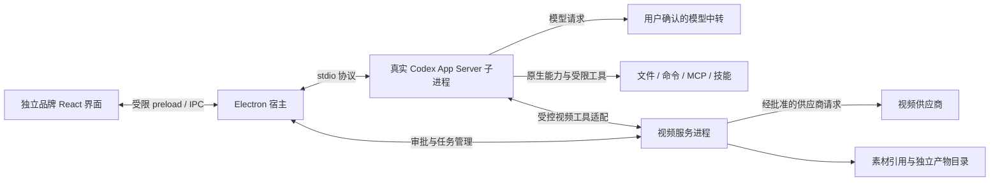

# 架构与模块边界

> 后续确认更新（2026-09-28）：品牌已定为demo，第3项前端方案与界面已确认冻结，见UI-001-BASELINE。下文v2草稿的未定名/待第3项表述保留其历史阶段；本次不扩大确认到其余开放架构或外部能力。

版本：UI-001 架构修订稿 v2，2026-09-28；依据 PRODUCT-SPEC v2。当前处于四项逐项审阅的第2项，供用户审阅，尚未冻结。本文件同时标明目标架构与代码现状；目标模块和接口未在本次实现。

## 1. 核心架构决定
**独立品牌桌面宿主 + 真实 Codex 运行核心 + 同一工作流中的视频扩展。**

- Codex 是默认核心，承担会话、上下文、Agent执行循环及其工具调用；不自行另写一个聊天Agent替代它，不把它降为可选插件。
- 保留 Electron + React + TypeScript 作为桌面宿主候选，Vite负责构建。当前没有需要推倒已运行外壳的证据；最终布局仍待第3项审阅，技术栈与界面一起确认后冻结。
- 主集成路线采用本机独立子进程的 Codex App Server，通过 stdio 连接；这是本架构的推荐决策，不是已完成的连接或用户已冻结的选型。SDK/一次性exec不作为主会话循环的第二套实现。
- 视频通过受控工具接口进入 Codex 会话，界面也可直接准备和审批视频任务；二者调用同一 VideoService，共用权限、任务ID和产物记录。
- 完整官方客户端、官方云服务、模型账号和工具连接器不因集成运行核心而自动获得。缺口纳入能力对齐表，不能默默删减功能规范的目标。

## 2. 目标进程关系（尚未实现）

宿主拥有 RuntimeSupervisor、会话索引、WorkspaceService、ApprovalBroker 和设置/凭据代理等逻辑模块。视频网络请求、任务轮询和媒体处理在单独子进程，避免阻塞窗口和Codex事件处理。不引入云后端、消息队列或通用插件执行框架来搭这轮骨架。

进程分离提供生命周期与故障隔离，不自动等于操作系统安全隔离。Codex/工具能访问的路径、网络和进程范围须用选定版本的Windows沙箱及执行策略验证；无法强制执行的权限不能仅靠提示词保证。

## 3. 模块职责和唯一执行者
| 模块 | 应负责 | 不应负责 |
| --- | --- | --- |
| Renderer / preload | 会话与事件展示、任务输入、审批表单；只暴露窄接口 | 持有凭据、启动进程、直接调用供应商或转发任意IPC |
| RuntimeSupervisor / CodexClient | 受控启动、版本检查、协议握手、请求关联、退出/恢复、事件投递 | 模拟Codex结果或重写推理与工具循环 |
| SessionService | 产品会话与Codex thread/turn映射、UI偏好、事件投影 | 私自改写Codex历史文件，维护一套相冲突的真实执行状态 |
| WorkspaceService | 路径授权、仓库/分支/worktree元信息、会话工作区绑定 | 自动扫描或修改未授权项目；把目录选择等同全部操作许可 |
| ApprovalBroker | 接收真实审批请求、验证用户决定、绑定操作、过期和撤销 | 将模型说“已批准”或前端布尔值当成授权 |
| VideoService | 统一预览/审批/提交/查询/取消/对账、供应商适配、任务账本 | 未经审批收费，凭空产生进度，覆写原始素材 |
| VideoToolAdapter | 把Codex工具请求转换为同一VideoService的请求与结果 | 单独保存另一套任务或绕过审批直接调用供应商 |
| Extensions / ToolGateway | 来源、能力、权限、生命周期、上下文归属；承接MCP/技能/插件/电脑/浏览器适配 | 自动认为所有官方扩展兼容，给外部描述执行权限 |
| Secrets / diagnostics | 系统安全存储、按需向获准进程提供最少凭据、脱敏诊断 | 把密钥写入草稿、renderer、事件、Git或普通日志 |

Codex生成的命令/文件操作交其已验证的原生执行链处理；宿主负责审批与可视化，不把同一事件再执行一次。宿主直接发起的Git、手动终端、电脑或浏览器操作是独立操作来源，必须走同一权限原则并标明来源，不能靠隐藏的备用终端绕过Codex审批。

## 4. Codex 接入与生命周期
1. RuntimeSupervisor选择并验证明确路径的Codex可执行文件，固定并记录受测版本、分发来源和许可信息；拒绝悄悄调用PATH里的另一个版本。首阶段可绑定受测安装，安装包是否内置运行时留作分发决策。
2. 使用产品专用配置和数据根，禁止覆盖用户已有Codex配置、历史或登录状态。凭据按用户确认的方式提供；身份/中转配置不可用则清楚阻断，不偷偷切换供应商。
3. 以参数数组启动子进程而非拼接shell命令；环境变量使用允许清单。默认每个产品配置档一个App Server，多项目由独立thread绑定工作区。若运行版本无法实现所需隔离，再以配置档/工作区拆进程，不能把多会话当安全隔离。
4. 完成连接握手后才开放会话执行。维护请求ID、进程代次和thread/turn/item关联；stdout仅作协议，stderr脱敏限量记录，处理分包、坏消息、超长事件、超时和背压。
5. 进程退出立即将运行状态改为“连接中断/待恢复”，不得显示成功；重启后查询并恢复已有thread，核对状态后继续。超时不是“请求未执行”的证据，不自动重放有副作用的请求。
6. 取消先发运行时中断并等待终态；无响应时让用户明确选择结束本应用拥有的进程树，标记结果未知，不关闭其他Codex实例。退出应用前处理未保存输入和仍在运行的本地/远程任务。

采用官方稳定协议并依据锁定版本生成/检查类型；未知事件可记录为不支持，未知审批请求默认拒绝或保持阻塞。实验能力须逐项显式启用和测试，不能为方便默认全开。

## 5. 接口边界
### 已实现接口：不在本次修改
`shared/contracts.ts` 是当前可执行契约：getState、chooseProject、createSession、renameSession、saveDraft 五个 Promise 方法，仅本地草稿。主进程仍保留来源/主frame校验、Node禁用、隔离与沙箱、严格CSP、导航/窗口/权限限制。原有数据限额与文件保护不变。

### 后续产品接口草案：名称不是官方API，也不是已有代码
| 产品接口族 | 输入 / 输出边界 |
| --- | --- |
| runtime.inspect / connect / disconnect | 受信配置ID → 版本、状态、能力和可读错误；前端不提供任意进程路径或参数 |
| conversation.create / resume / read | 已授权workspaceId、产品会话ID → 产品ID与Codex thread映射、实际状态 |
| conversation.startTurn / interrupt | 会话ID、输入、受控模型选择 → 关联turnID；返回受理不等于完成 |
| events.subscribe | 授权会话/任务范围 → 带来源、关联ID、类型和本机序号的事件；可取消订阅、合并高频增量 |
| approvals.respond | 宿主生成的approvalId、用户选择 → Broker核验后回应原请求；不接收“自行声明已批准” |
| video.prepare / submit / inspect / cancel | workspace/session绑定、素材ID、参数或已批准任务ID → 预览/真实任务/实际状态 |
| workspace / extensions / settings | 分任务增加受控动作，来源和权限可查；不暴露万能execute或原始配置文件写入 |

接口统一返回可处理的错误码、用户信息、是否可重试及关联ID；可重试不代表可自动重复有副作用操作。凭据字段和原始供应商响应不能无过滤透传renderer。

### 工具入口
视频工具优先通过本地MCP适配器接入Codex，走视频服务的同一审批/提交管线。具体工具schema、传输和鉴权在接入任务验证后定稿；不以开启实验性动态工具作为默认前提。

工具调用的会话/工作区归属必须来自经验证的运行时关联或宿主签发的短期能力上下文，不能信任模型传来的路径、threadId或approved字段。适配器与服务连接须验证调用进程/连接、范围和有效期；若选定协议不能可靠传递归属，先隔离连接或禁用执行，不能省略归属校验上线。

## 6. 权限与审批
- 产品审批是对运行时请求与扩展操作的统一呈现和校验，不应抹掉原生沙箱或静默降低其策略。批准只回应具体请求，不创建永久万能权限。
- 每次授权绑定操作种类、规范化目标、参数摘要/哈希、会话、工作区、来源请求、有效期和一次性使用状态。执行前再次核对；请求变化、拒绝、超时、进程换代或会话取消使旧授权失效。
- 删除展示具体路径、数量和影响；付款、注册、发消息、账号权限变更执行前再次确认。模型或插件的声明不能代替用户决定。
- 原生执行链并不保证每个工作区写操作都上报审批。接入验收必须证明危险动作不能从普通shell、脚本、MCP或网络旁路绕过确认；不能只加一个UI确认框或关键词过滤器。
- 未验证上述强制边界前，相关危险执行能力保持禁用/只读并公开标为差距；不能用“全自动/完全访问”兜底。对无法确定影响的任意命令，先提供可审阅操作并获授权，不能假设其安全。
- 工作区路径需处理Windows大小写、真实路径和链接/junction越界；授权的目录选择不等于允许读取其外部目标。凭据/运行数据目录不向Agent、媒体输入或插件开放普通文件访问。

## 7. 数据所有权与恢复
| 数据 | 权威来源 / 本产品持有内容 |
| --- | --- |
| Codex会话与执行历史 | 运行时及其受支持协议为准；产品保存索引与映射、可重建事件投影，不直接改内部历史 |
| 本地草稿及UI状态 | 宿主持久化；当前sessions.json保留，后续通过有备份/可回退的schema迁移接入真实会话，不能自动把草稿视为已发消息 |
| 项目/工作区 | 产品保存获准路径和元信息；源代码仍属于用户项目，Git实际状态只读核对后呈现 |
| 视频任务 | VideoService账本保存产品任务ID、供应商ID、请求指纹、状态、会话映射、审批记录和产物引用 |
| 素材/产物 | 原始素材只引用或经授权复制；生成结果写独立输出目录，记录输入指纹，原文件不覆盖 |
| 密钥/登录 | 系统安全存储或运行时支持的安全方案；产品索引只持有凭据引用，不持有可显示的明文 |

当前开发数据仍在项目.local，产物outputs，均不入库。安装版可写用户数据根、加密存储、备份迁移以及运行时专用配置目录，必须在相应实现任务确定；本轮不迁移、不读取其他应用秘密、不自动清理数据。

事件顺序由运行时/供应商状态驱动，本机序号仅为投影顺序，不冒充官方可续传游标。重连先恢复快照再对齐事件；重复事件去重，状态不明确显示“待核对”，不能靠缓存冒充完成。

## 8. 视频完整路径与防重复收费
1. Codex会话或界面发起prepare，服务规范化素材/参数、供应商能力及费用信息，形成可审阅请求；未知价格明确标注，不编造金额。
2. 用户确认具体提交后，Broker生成一次性授权；VideoService校验请求指纹与绑定，并先持久化提交意图和产品任务ID。上传使用批准时经授权保存的不可变素材副本，或在实际读取/提交时核对内容指纹；内容变化即停止并重新prepare/审批，不能仅凭原路径复用批准。
3. 服务以任务ID作为本地去重键；供应商支持时再使用其幂等机制。若请求已发送但回包丢失，置为“提交结果未知”并先查询/对账；未确定前不自动重发收费请求。
4. 记录真实供应商任务ID，再轮询或验证回调获取状态。进度无法获得时展示状态而非虚构百分比；关闭界面不等于取消远端任务。
5. 原素材、参数或供应商变化必须重新prepare/审批。远端取消仅在供应商确认后显示已取消；供应商不支持时明示限制。
6. 下载结果到独立路径，失败可恢复；将任务与产物同时映射回原会话/项目。用户查看、Codex查询和UI列表读取同一账本，不重复启动任务。

## 9. 目录演进与能力对齐
当前真实目录仍是electron/main.ts、preload.ts、store.ts，shared/contracts.ts，src，scripts，tests，docs。本轮没有新建运行模块。

| 后续落点建议 | 对应职责 | 创建条件 |
| --- | --- | --- |
| electron/codex/ | Supervisor、协议客户端、事件映射 | CODEX-001落地时，从main抽取实际新增职责 |
| electron/workspaces/、electron/approvals/ | 工作区授权、审批代理 | PROJECT-001、APPROVAL-001实际实现时 |
| services/video/ | 视频服务进程、账本、供应商适配、工具入口 | MEDIA-001/VIDEO-001分期落地时 |
| shared/ 内按领域拆契约 | 受限产品命令与事件 | 实际接口加入时；官方协议类型与产品类型分开 |
| src/ 内按会话/项目/视频等职责扩展 | 共享同一工作环境的展示 | 第3项界面审阅后，不按当前六导航机械复制业务层 |

多Agent由运行时支持的真实能力和宿主工作区协调承接；MCP/技能/插件各自核实来源与生命周期；电脑/浏览器由已验证工具适配承接；模型中转由Codex支持的配置入口适配，不另建第二个推理循环。官方云端或宿主专有能力单列差距，未核实不删除要求，也不宣称已继承。

## 10. 接入顺序与评审检查点
1. 核实参考Codex产品/版本及可复用能力，验证本机运行时启动/协议/中转兼容；不先造一套通用模型聊天层。
2. 建立工作区、会话映射、事件和恢复，再接审批及受控执行；有副作用能力在权限边界验证前不开放。
3. 逐项承接终端、差异、多Agent、工具与扩展，逐项登记对齐证据和缺口。
4. 先素材与视频请求准备，再按供应商能力接入审批、提交、对账和结果；所有入口共用服务。

架构评审要求：每项产品能力有责任归属；运行时崩溃不伪成功；危险动作不能旁路；视频不因重试重复收费；原有草稿可迁移；未实现明确显示。上述为后续设计/接入检查点，不替换或冒充当前ACCEPTANCE的已运行证据。

## 11. 依据和当前限制
- 官方 [App Server](https://learn.chatgpt.com/docs/app-server)：支持stdio逐行JSON，连接先initialize/initialized；会话及回合有start/resume/interrupt等协议，审批以服务端请求回传用户决定。具体字段以锁定版本schema为准。
- 官方 [Codex as a platform](https://developers.openai.com/blog/codex-as-a-platform)：可复用核心是Agent执行系统，模型访问及托管服务独立；本方案据此复用运行核心并自有宿主/视频服务。
- 当前运行代码尚无上述Codex、视频、审批或扩展服务；只有已验证的本地草稿骨架。本文改架构设计，不代表软件已具备目标能力。

仍需后续确认/验证：参考版本、运行时分发与升级、模型中转协议、Windows强制权限边界、视频供应商/费用/幂等/取消能力、工具归属和插件格式。以上不会阻止本稿具体表达设计，但未验证前不得宣称兼容或上线能力。本轮不改界面、不安装运行时、不调用模型、不索取密钥，不冻结骨架。
